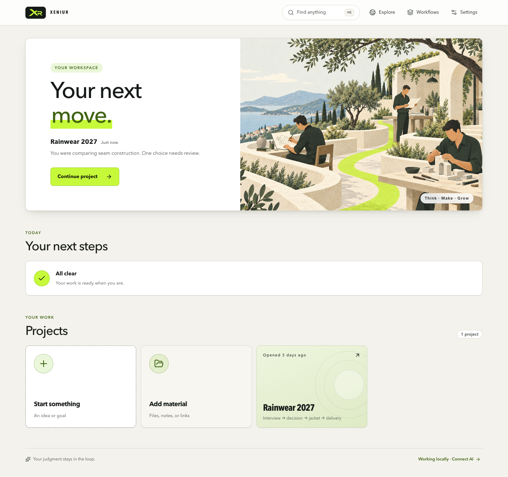

# XENIUR

A desktop workspace for turning sources and ideas into work you can use—and explain.

Start a project, bring your material, and follow a visual path. Keep the evidence, choices, and reasons alongside what you make, so you can revisit them when something changes.



## What it does

- Research reviews and reports of real experiments or prototypes.
- Brand directions, scientific figures, marketing plans, and product listings.
- Scripts, illustrated storyboards, and small web projects.
- Project browsing: compare pages, keep sources, and return to your work.
- Evidence inspection and short thinking checks at useful stopping points.

Your projects stay on your computer. AI steps use **one OpenRouter key** for text and images, and show an estimate before running. You can also work with local files without AI.

## Run it

Install Node.js 22, then:

```sh
git clone https://github.com/saap1tech/XENIUR.git
cd XENIUR
nvm use 22
npm ci
npm run dev
```

[Installation and desktop packages](docs/INSTALLATION.md) · [Documentation](docs/README.md)

## Current status

**Early alpha.** Review AI drafts and citations before using them. Video generation and generated 3D are planned for later. Signed releases, live-model verification, and testing on clean Windows/Linux machines still need completion.

## Contribute

Try a real task and tell us where you got stuck. Fixes, useful workflows, accessibility work, and tests are welcome. See [contributing](CONTRIBUTING.md) and [security](SECURITY.md).

[MIT license](LICENSE). Bundled fonts and dependencies keep their [own licenses](THIRD_PARTY_NOTICES.md).
