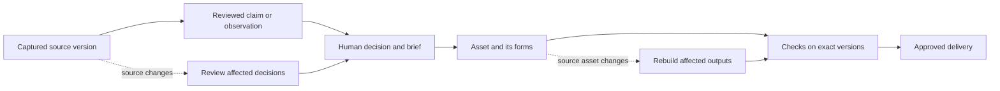

# XENIUR M3 — from sources to accountable delivery

**Decision plan · 6 September 2026 · based on the current M2 repository and fresh research.**

This supersedes the next-build recommendations in the 5 September strategy and V1 plan. M2 has already implemented their major architectural proposals. It does not need another scaffold. It needs a dependable product loop and evidence that somebody will repeatedly use it.

Read alongside the [M2 recheck](/Users/developer/development/Xeniun/docs/M2_RECHECK_2026-09-06.md) and [ordered engineering backlog](/Users/developer/development/Xeniun/docs/XENIUR_M3_BACKLOG.md). The recheck distinguishes executed tests, reproduced defects, code inspection, and untested claims. Recommendations, customer selection, prices, and success thresholds below are hypotheses; none represents demonstrated demand.

**1. The business to build**

Build **an open-source creative workbench that keeps the reasons, source material, revisions, and delivery evidence attached to the work**.

Suggested public positioning:

> XENIUR keeps your references, decisions, and deliverables connected. When something changes, see what needs rebuilding, what needs review, and exactly what you handed over.

“Living Objects” is the underlying product idea. “Connected creative work” is a useful category description. Neither is a proven new market category. Lead demonstrations with a familiar customer problem: a reference or brief changed after the first delivery, and nobody wants to reconstruct the project by hand.

The most promising distinction is **continuity through revision**, encompassing both mechanical dependencies and human decisions. A persistent UUID is an implementation detail. The value is recovering why a choice was made, knowing which exports are current, and safely producing the next delivery.

Keep the universal environment as the long-term vision. The first release should serve one repeatable workflow thoroughly enough to become a habit. Booking tennis, shopping, general browsing, research, game creation, and media production do not share one initial buyer or one standard of success.

**2. What M2 changes**

M2 has two substantial experiences: an asset pipeline with representations, recipes, checks, and releases; and a thinking workspace with sources, atoms, links, and reflection. This is a stronger base than M1. Replacing it or repeating its schema work would waste progress.

Their connection is still incomplete. A Thinking Map link does not automatically become a version-pinned dependency of a delivered asset. Source capture does not preserve a complete source snapshot on the inspected capture path. Portable packages do not carry the complete sensemaking graph. A human decision does not yet have an explicit, durable contract connecting evidence to a build.

M3 should complete this loop:

The dotted paths are different. A changed mesh can mechanically invalidate an STL. A changed article can make a decision worth reviewing; it cannot mechanically prove the decision wrong. Preserving that distinction is central to the product.

**3. What current competitors establish**

This is a capability comparison from first-party pages, not a hands-on benchmark or an exhaustive assertion that competitors lack XENIUR's proposed features.

| Product family | What the current evidence establishes | Consequence for XENIUR |
| --- | --- | --- |
| Heptabase | Visual whiteboards, linked knowledge, source reading with AI, PDF annotations, web capture, and research integrations. [Product page](https://heptabase.com/) | A Thinking Map and source-aware assistance alone are insufficient differentiation. |
| Google's notebook product | The current NotebookLM help URL redirects to Gemini Notebook documentation. It describes source citations and experimental paid capabilities for downloadable artifacts and artifact versions. [Google documentation](https://support.google.com/notebooklm/answer/16179559?hl=en) | Do not position competitors as merely summarizers. “Research becomes an artifact” is already contested. |
| Kosmik | Positions itself around AI moodboard creation. [Product page](https://www.kosmik.app/) | Reference collection and a visual creative surface need a stronger downstream payoff. |
| FLORA | A multimedia canvas with editing steps, creative-brief PDF import, and export into asset management. [Product canvas](https://flora.ai/product-canvas) | Multimodal generation, visual workflows, and creative briefs are already present in the market. |
| Anchorpoint | Visual asset management and versioning, including Blender workflows and Git-based artist collaboration. [File versioning](https://docs.anchorpoint.app/assets/file-versioning/), [art assets](https://docs.anchorpoint.app/git/art-assets/) | File history and thumbnails alone will not justify switching an established team. Interoperate with existing project folders. |
| Kitsu | Production tracking for assets, tasks, and game projects, with self-hosted open-source deployment. [Game production](https://kitsu.cg-wire.com/videogame/), [documentation](https://kitsu.cg-wire.com/?from=madewith.cn) | Open source and review tracking are valuable attributes, not a sufficient market position. |

**Inference:** the opportunity worth testing is the combination of portable local ownership, explicit decisions, dependency-aware revisions, and release evidence. The search does not prove this combination is unique or defensible. A working demonstration and repeated use must establish its value.

Potential defensibility would accumulate through reliable import/rebuild adapters, shared delivery profiles with fixtures, an interoperable object format, and trusted workflows that survive tool changes. Model access, the number of packages, and a large canvas are weak advantages. Open source makes execution quality and distribution more important than withholding the graph implementation.

**4. Recommended initial customer**

Start with **independent 3D designers and small concept or product-visualization studios, roughly 2–10 people, already using Blender and handling repeated client revisions**. Initially recruit macOS users because that is the tested environment. The first buyer is the owner or lead designer; the daily user is the person responsible for preparing and revising deliveries.

Qualify by workflow, not title: they should have recent projects combining references, explicit design choices, an editable source asset, multiple exports, and at least two review rounds. Start with visual prototypes and presentation assets. Engineering qualification, production manufacturing, and safety certification are outside the promise.

| Starting market | Fit with M2 | Commercial hypothesis | Main objection | Decision |
| --- | --- | --- | --- | --- |
| Small Blender concept/visualization studios | References plus asset revision use both halves of M2 | Repeated revision and handover costs may support payment | Additional project bookkeeping may outweigh savings | Primary interview and pilot cohort |
| Small game-asset teams | Strong existing asset loop | Export correctness and revision history matter | Engine integration, team collaboration, and established version control raise expectations | Secondary comparison cohort; do not promise engine readiness prematurely |
| Research consultants and analysts | Strong source/decision fit | Client evidence and handover can matter | Asset workers add little; document/table workflows need more work | Expansion candidate if interviews show stronger demand |
| Students and personal knowledge users | Strong sensemaking appeal | Broad interest possible | Payment and repeated delivery pain unproven; crowded alternatives | Community audience, not initial revenue thesis |
| General personal AI assistant users | Matches the broad vision | Potentially broad use | Many unrelated jobs, identities, risks, and competitors | Defer as a launch market |

This refines the earlier game-asset recommendation because the new sensemaking system makes evidence-to-design workflows plausible. Do not treat the refinement as customer validation. Run six interviews in the primary cohort, three with game-asset teams, and three with research/design consultants before committing to specialized new integrations.

Ask each person to show their most recent revision incident. Identify what changed, how they found affected work, how long correction took, what was delivered incorrectly, and what tool they paid for already. Request a sanitized project for a supervised trial. Avoid asking whether they like the idea of “living objects.”

**5. The M3 customer experience**

The flagship workflow is **“Revise a client concept without losing the reasons or shipping yesterday's exports.”** Use a customer's asset in pilot sessions; retain the rocket as a regression fixture.

1. Create one project World with a named deliverable. Bring in the brief, two references, a personal sketch or observation, and an existing Blender asset. Show imported content immediately; expensive previews can finish separately.
2. Select a passage and keep a claim. Show its exact source version and location. Extraction may offer suggestions, but suggestions remain distinct from accepted notes.
3. Compare two design options. Record a decision with the chosen option, rationale, linked evidence, unresolved assumptions, and a review trigger. The person accepts the decision.
4. Attach the accepted brief version to the asset. XENIUR prepares the existing thumbnail, turntable, and selected delivery forms using a versioned recipe.
5. Show check results on those exact outputs. The person approves a delivery with its profile revision, evidence, and source/decision references attached.
6. Reimport a changed mesh or revised brief. Display affected outputs and decisions with the path explaining each impact. Keep unaffected work usable.
7. Rebuild deterministic outputs, review changed assumptions, compare the result with the previous delivery, and approve the second release.
8. Export ordinary usable files and a portable XENIUR package. In a clean installation, open the package and inspect the same two releases, their reasons, and their evidence.

The decisive demonstration is step six. A first generation looks impressive; a correct second delivery proves why the workspace exists.

Keep the World and current Object UI. Use a clear project entry with **Bring something in**, **Continue work**, and **Review changes**. Within a project, expose Sources, Decisions, Work, and Deliveries as contextual views. Do not show every subsystem as an equal destination on first use.

The Object inspector should answer: What is this? Which forms are current? Why was it made this way? What changed? What can I safely do next? Show the graph on demand. Add an impact list before investing in another graph visualization.

Keep direct buttons and the command palette authoritative. Natural language should call the same services. A person must be able to complete the full loop offline without learning prompt phrasing.

**6. Fix the meaning of evidence before extending it**

The executed recheck reproduced three misleading evidence/origin outcomes and a negation similarity failure. These are product correctness issues because trust is the central value proposition.

**Version-bound checks.** A check must identify the exact representation or object snapshot it measured, validator version, parameters, and execution environment. Store check runs append-only. Readiness must reject mismatched, missing, stale, or incompatible evidence. Release approval must bind its version, profile hash, and selected check IDs in one consistent operation. Existing releases remain historical facts; they do not automatically approve new versions.

**Specific claims.** “Passes our prototype mesh checks” is defensible when those checks ran. “Ready for Godot,” “Ready for App Store,” “Verified fact,” and “Ready for publication” imply much more than a polygon count, icon size, or freshness test establishes. Rename broad prototype profiles or add the actual target validation before promoting those labels.

**Origins and contributions.** Separate four questions: where did the source come from; who or what produced each operation; what evidence supports a claim; and what reuse occurred? A cited external source can contain AI-generated material. An unknown import is not proof of AI origin. A technically valid image is not a verified factual statement. A generation applied to a human source must remain visible as generation even though its lineage root is human.

Replace the current universal Low Human Signal inference with precise descriptions such as “All recorded roots are generated,” “Origin unknown for one input,” or “One personal observation is included.” Keep counts and inspectable paths. Treat ingredient reuse neutrally unless the user explicitly asks for diversity; repeated roots can be desirable for a consistent collection.

**Thinking Map language.** Use “Your assessed claims,” “Possible disagreements,” “Similar wording,” “No earlier lexical match found,” “Claims without linked support,” and “Open follow-ups” until stronger semantics are implemented. A confidence rating of zero cannot reasonably mean “what I know.” An evidence-like sentence elsewhere in an article cannot support every claim in that article. Different capture IDs do not establish independent sources.

Model-assisted relation suggestions can improve usefulness, but must carry evidence and await review. Citation validity, factual truth, source independence, and the user's confidence are separate properties.

**7. Make source capture durable**

Represent each captured source as an Object with immutable source versions. Store original content when available and authorized, normalized text, content hash, retrieval time, canonical URL or publication identifier, author metadata, and extractor version. When only an excerpt is available, explicitly record partial capture; do not fabricate the surrounding source.

Bind every atom to a source representation and locator. Use exact quote plus surrounding context and a position/time selector. The W3C Web Annotation model provides existing text-quote and text-position selector concepts; adapt them instead of inventing an incompatible locator vocabulary. [W3C specification](https://www.w3.org/TR/annotation-model/)

Keep extracted candidates separate until accepted or edited. Record the human move with the affected Object/version, rather than just a world-level event. Make an observation about another atom a neutral reference by default; support and contradiction must be explicit relationships.

Start source identity with content hashes, canonical URLs, publication IDs when available, and manually reviewable grouping. Label “independence unknown” when two publications may repeat one underlying report. M3 need not solve automated fact-checking or universal duplicate detection.

Persist confidence, relation edits, decision acceptance, and supersession in versioned data or immutable events from which the view can be reconstructed. Reopening an old delivery should show what was believed and accepted then.

**8. Introduce a real Decision Object and dependency contract**

A Decision is an ordinary Object with typed, versioned properties: question, considered options, chosen option, rationale, evidence references, assumptions, acceptedBy, acceptedAt, review triggers, and superseded decision/version. Draft, accepted, needs-review, and superseded are explicit states.

An evidence reference identifies a particular source/claim version and the relationship being asserted. Do not express all meaning as transformation lineage. A document can cite a study without being mechanically reproducible from it; two claims can contradict without either being an output of the other.

Keep representation-level action lineage for actual transformations. Add version-pinned semantic dependencies for supports, contradicts, informed-by, satisfies, and review-on-change. Define which relationships propagate rebuild status and which propagate human-review status. Detect cycles and bound traversal. Do not quietly create a second competing source of truth for existing atom links.

Make briefs ordinary Markdown/structured representations generated deterministically from accepted decision data first. Bind recipe inputs to exact brief and asset versions. Offer a model-written draft as an optional candidate later. This completes the business workflow without buying image, mesh, or video generation.

**9. Add the Brain now, within a narrow contract**

The guide's recommendation is partly right: real intent understanding can make the existing tools easier to use. Enabling the model alone does not connect the product or make existing evidence reliable. Implement the bounded adapter after the command, approval, and budget fixes; pilot it while the source-to-decision work proceeds.

The official model page currently lists `gpt-5.6-luna`, with standard short-context text prices of **$0.20 per million input tokens and $1.20 per million output tokens**, and support for structured outputs. This verifies a candidate model and price as of 6 September 2026; it does not authorize a paid call or prove suitability. [Model documentation](https://developers.openai.com/api/docs/models/gpt-5.6-luna)

Illustrative arithmetic: 3,000 input tokens plus 500 billed output tokens is $0.0012 at those rates, or $1.20 for 1,000 such requests. Actual cost also depends on retries, reasoning/output usage, caching mode, service tier, and any tools. Keep the verified price source, date, billing mode, and model identifier in configuration. Unknown prices or usage must never silently become zero.

Use schema-constrained Responses output with a discriminated result: executable plan, clarification needed, or unsupported request. A tool name must select its own strict argument schema. Bind object IDs, form roles, current versions, and capability availability from the runtime registry. The model cannot choose permission policy or approve itself. Structured output improves format compliance; semantic validation remains XENIUR's responsibility. [Structured outputs](https://developers.openai.com/api/docs/guides/structured-outputs)

Initial supported requests: explain a selected check; find source evidence already captured; propose a decision draft; choose an existing local transform; describe the rebuild impact; prepare a delivery preview. Explanations may contain prose, but executable commands remain a separate validated structure. Unsupported actions produce an honest response.

Handle refusal, incomplete output, timeout, cancellation, rate limits, and ambiguous target selection. Persist every billable planning attempt, including repair and failure, with a request ID and measured usage. Reserve a worst-case permitted amount before dispatch so concurrent tasks cannot exceed the local limit through separate checks of settled spending.

Retain a fully usable offline mode and clear cloud status. Send only selected source excerpts and object state. Use `store: false` where applicable, but do not describe it as zero retention: OpenAI documents separate application-state and abuse-monitoring retention controls. [Data controls](https://developers.openai.com/api/docs/guides/your-data)

Proposed first paid test budget: $5 total, after explicit configuration and credential setup by the owner. First run an offline mocked response suite. Then evaluate 50 representative real requests within the cap, expanding only when a specific failure merits investigation. Do not enable Meshy, Runway, or image generation during this milestone.

**10. One execution path for UI, models, and recipes**

Keep the existing twelve packages. Introduce no new distributed service or package simply to express this plan. Put shared application command handlers in the desktop service layer and reuse the existing graph, task, permission, and router packages.

Every command should bind the target World/Object/branch, expected base version, exact inputs, validated arguments, and effect scope. Preview and execution must consume the same normalized plan. Replace blanket approval booleans with an authorization record bound to the concrete plan digest, inputs, destination, spend limit, and expiry. If those change, the approval is no longer applicable. Ordinary reversible local edits remain automatic.

Put long imports, rebuilds, validation, packaging, and planning in the task queue. Add persistent per-step state, worker/resource limits, cancellation propagation, and action reconciliation after interruption. Pure local computations can be retried from pinned inputs; an uncertain external effect requires reconciliation rather than blind replay.

Commit against the expected base version. A job finishing after the user edits must create a visible candidate or conflict, not quietly publish into the new head. Include tool versions and relevant environment in recipe fingerprints. Promise byte-identical output only for transforms proven deterministic within the declared environment; for other operations report semantic equivalence or a new artifact honestly.

Harden the existing untrusted file/view boundaries before public distribution: archive path and link handling, bounded extraction, schema and hash verification, exact navigation origin checks, and hostile generated-preview fixtures. Code inspection found areas requiring tests; the recheck does not claim a complete security audit.

**11. Portability becomes a product contract**

Define package version 2 around a selected delivery and its dependency closure: Object identities, needed versions/forms, producing actions and inputs, source snapshots, accepted atoms/links, decision revisions, recipe revisions, checks, profile definitions, and releases. References outside the package must be explicit unresolved references, never silently dangling foreign keys.

Support two export intents. An archive preserves the selected full working history. A delivery package includes the selected release and disclosed supporting material. Preview included sources, private notes, prompts, local paths, and size before sharing. Source attribution and permission to redistribute are distinct metadata; unknown rights should remain visible.

Keep ordinary GLB/STL/images/video and a readable Markdown/HTML delivery report alongside the portable archive. A recipient should get usable work without installing XENIUR. Local-first principles include ownership and longevity beyond one application, not merely a local database. [Ink & Switch](https://www.inkandswitch.com/essay/local-first/)

Validate an archive completely before committing metadata. Check bounded expansion, file types, paths, hashes, referential closure, and collisions. Existing identity import needs an explicit identical/descendant/divergent decision. M3 can reject divergent merges with an explanation; it must not report a newer package as successfully incorporated when it skipped its contents.

**12. Test the anti-feed rather than making scientific claims about it**

The human-first direction is valuable. The available research does not validate an origin score or prove that a prompt after eight captures improves judgment. A short-story experiment found individual creativity benefits alongside greater similarity across AI-assisted stories; its scope does not establish a universal novelty detector. [Doshi and Hauser](https://arxiv.org/abs/2312.00506)

A CHI study surveyed 319 knowledge workers about AI and critical thinking. Its self-reported associations motivate careful workflow design, not a causal claim that AI necessarily weakens thinking. [Study](https://www.microsoft.com/en-us/research/wp-content/uploads/2025/01/lee_2025_ai_critical_thinking_survey.pdf)

Keep reflection prompts dismissible and configurable. Separate deliberate bulk import from ongoing consumption. Avoid moralizing origin labels and progress streaks. In pilots, compare whether the prompt helps users articulate a decision or find a missing source, how much time it costs, and whether they disable it. Keep it if users find value; do not make it the adoption obstacle.

**13. Open-source business and distribution**

Recommend Apache-2.0 for XENIUR-owned application code, subject to confirming ownership and dependency obligations before release. It is an OSI-approved permissive license with patent provisions. This is a proposal; no license has been applied by this planning work. The application's license does not replace licenses for bundled tools, models, or imported assets. [License text](https://opensource.org/license/apache-2.0)

The free local product should include identity, history, import/export, recipes, checks, decisions, the offline workflow, and bring-your-own-provider support. Do not put data recovery or portability behind payment. Sell conveniences that cost money or require ongoing service: managed backups and restore, hosted delivery review, shared workers, team administration, and support. Build these only when pilots show demand.

Start revenue with a tightly bounded service that exists before cloud infrastructure: setup, project migration, one delivery workflow, and support through two revision rounds. Test a **$300–$1,000 fixed pilot price**, depending on agreed work; it is a pricing experiment, not an established market rate. Avoid bespoke features for every customer. Two paid pilots can validate willingness to pay for the problem while still failing to validate SaaS retention.

After demand is observed, test an optional hosted team plan around **$49–$99 per small team per month**, with explicit storage and worker limits and separate provider usage. These are interview anchors. For illustration, 100 teams at $79 is $7,900 monthly revenue before infrastructure, support, payment fees, and taxes; it is not a forecast. Measure support hours and worker cost before treating that price as sustainable.

Before public launch: add the chosen license, attribution inventory, contribution instructions, security reporting, supported-platform statement, packaged installer, migration/backup recovery guide, and sample projects with clear asset rights. Use small reviewable contribution areas: importer adapters, validators, recipe examples, documentation, and test fixtures. Delay executable community plugins until a capability boundary and compatibility tests exist.

Distribution starts with a short “second revision” demonstration, a downloadable sanitized project, and direct trials with the interview cohort. Publish measured case studies with customer permission. Open-source stars are useful reach, but repeated delivery is the adoption signal.

**14. Work sequence and release gates**

Assume one full-time engineer plus founder-led interviews. Allow roughly eight weeks as a planning envelope, not a delivery commitment. Re-estimate after the first correctness pass. If capacity is smaller, preserve the sequence and cut breadth.

| Stage | Work | Gate before moving the release forward |
| --- | --- | --- |
| First 48 hours | Preserve M2 baseline; reproduce and ticket trust defects; define one pilot scenario; begin recruiting interviews | Executable regression cases and explicit M3 scope |
| Weeks 1–2 | Version-bound evidence; honest map/origin labels; archive validation; shared command/approval path and concurrency controls | Old evidence cannot approve new output; malformed imports leave no state; obsolete jobs cannot overwrite current work |
| Weeks 3–4 | Durable source capture; accepted candidates; Decision Objects; versioned brief dependencies; bounded Brain experiment after its controls pass | A decision links to an exact source passage and a build links to the accepted decision version |
| Weeks 5–6 | Change-impact review; rebuilt/reviewed second delivery; package closure and readable handover | Full source-to-second-release loop survives export/import on a clean instance |
| Weeks 7–8 | Pilot revisions, installer and recovery, documentation and open-source preparation | Users repeat the workflow independently; critical regressions and release blockers resolved |

Run interviews throughout. If the initial customer evidence contradicts the selected market, change the template and output emphasis before adding specialized integration work. Do not keep building eight weeks of features merely because the schedule exists.

**15. Acceptance criteria and decision rules**

Engineering gates must be behavioral. In addition to keeping existing tests green, exercise changed-source evidence, concurrent edits, cancellation, recovery, forged approval inputs, hostile archives, cross-object package closure, unresolved citations, unknown origin, negation, duplicate captures, and mock-derived outputs.

Model evaluation starts with 100 offline contract/adversarial cases and 50 labeled real pilot requests. Require zero unauthorized effects and zero invalid accepted references in that set; require at least 95% correct tool/target/argument mapping on supported unambiguous requests. Report abstentions and unsupported requests separately. A finite test set does not prove universal safety or reliability. Add human judgments of whether source passages actually support suggested claims; a valid character range is insufficient.

Proposed usability targets: a new user imports and inspects their own asset within ten minutes; can explain a blocked check without developer help; and can complete a second release without losing the first. Measure expensive rendering time separately from active user time.

For five pilots over four weeks, seek at least three completing a second real revision cycle and at least two paying for a bounded pilot or making a concrete paid-service commitment. Measure median active time against their previous workflow, tracing success for delivered decisions, delivery mistakes, support minutes, and continued use after assistance stops. These are go/no-go heuristics, not statistically representative market evidence.

If users only return for capture, test the research-to-brief workflow before expanding 3D. If they only return for asset rebuilds, simplify the first-run thinking surface and deepen asset delivery. If they repeatedly reconstruct reasons outside XENIUR, improve the decision bridge. If bookkeeping costs more time than it saves after two revisions, simplify the required inputs before adding automation.

**16. What to defer**

Defer session delegation, autonomous purchasing/posting, generalized code execution, additional generative media providers, multi-device synchronization, a plugin marketplace, Windows/Linux promises, and universal truth/creativity scoring. Keep their interfaces when useful; do not make them public launch claims.

Authenticated web action should return only after multiple retained pilots need the same concrete action. Prefer purpose-built connectors or explicit dedicated login with narrow task authorization. A domain-scoped browser grant cannot by itself restrict what a logged-in website account can do. It needs a separate effect policy and concrete action confirmation.

**Immediate priority:** make a green readiness result trustworthy, preserve the source behind a claim, and make the second delivery demonstrably easier than the first. That is the shortest credible route from the current M2 implementation to a useful open-source software business.
