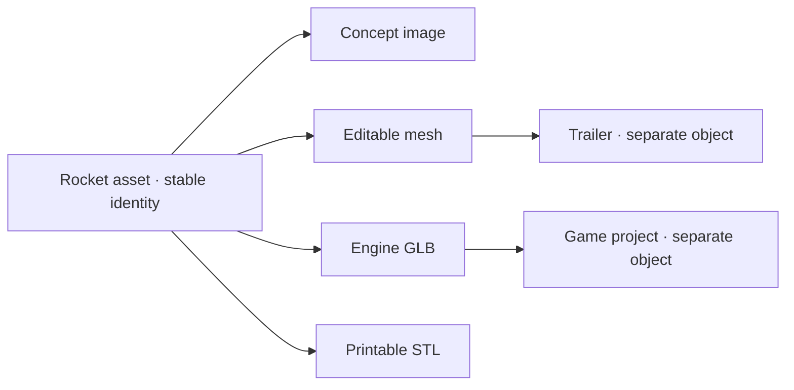

# XENIUR — product and business strategy

Research and repository review: **5 September 2026**. This is a proposed direction, not a claim of product–market fit. Competitor capabilities below come from first-party sources; customer demand, pricing, and differentiation remain hypotheses to test.

**Recommendation.** Build XENIUR as an **open-source workspace for living creative assets**. Start with small commercial game-asset teams that repeatedly move assets through Blender, revisions, and engine delivery. Sell dependable revision and delivery: a creator changes an asset, sees what becomes outdated, rebuilds the affected outputs, and delivers a checked package with its history intact.

The durable product promise is: **“Your asset keeps its history. Every delivery stays connected.”**

The existing universal computing vision can remain the long-term destination. The first customer needs a specific reason to use XENIUR this week. That reason should be recovering, revising, and delivering real work.

Read the [repository audit](/Users/developer/development/Xeniun/docs/PROJECT_AUDIT.md) for verified implementation findings and the [revised V1 plan](/Users/developer/development/Xeniun/docs/XENIUR_V1_PLAN.md) for the corresponding architecture and release gates.

**1. What is valuable in the original idea**

The Object is a strong organizing principle: people recognize “the rocket,” while tools expose images, meshes, textures, project files, and exports. Preserving that recognizable identity across operations can reduce the work of reconstructing context.

The graph, deterministic tools, provider boundary, and local database are useful foundations. They enable a product whose value persists when a generation API changes or a user chooses to use no generative AI at all.

The weakness is the breadth of the initial promise. Illustration, video, 3D, application generation, shopping, legal drafting, booking, and browser identity are several product businesses with different quality standards and buyers. A full architecture scaffold can contain these interfaces; a public release must make a much smaller set of promises reliably.

Also, history alone is insufficient. Users will rarely pay to inspect an ancestry graph. The graph earns its place when it answers: “What did this change break?”, “Which version did we ship?”, and “Can you rebuild the delivery without losing my edits?”

**2. What the research changes**

| Existing approach | Evidence from the vendor | Implication for XENIUR |
| --- | --- | --- |
| Visual AI workflows | FLORA combines models on a canvas, collaborative iteration, and reusable workflows. [FLORA](https://flora.ai/) | A canvas, multiple models, and reusable recipes are already competitive expectations. |
| Generative tools plus editing | Figma Weave combines model nodes, professional editing operations, and simplified tools built from workflows. [Figma Weave](https://weave.figma.com/) | “Generate and edit in one place” is not a sufficient position. |
| Local open-source generation | ComfyUI supports node workflows locally and offers optional cloud execution and paid model access. [Comfy](https://support.comfy.org/articles/9806306061-about-comfy) | Integrate with established execution ecosystems. Openness and local generation alone do not differentiate XENIUR. |
| Local knowledge workspaces | AFFiNE merges documents, whiteboards, and databases and describes itself as local-first. [AFFiNE](https://affine.pro/) | “Local-first world of objects” overlaps with an established workspace category. |
| Creative asset version control | Anchorpoint provides Git-based asset management, locking, and workflows for nontechnical creators. [Anchorpoint](https://www.anchorpoint.app/) | History, previews, and asset organization must exceed the value of an existing file workflow. |
| Production tracking and review | Kitsu provides asset/shot tracking, versioned previews, review, APIs, and paid hosting/support around an open-source product. [Kitsu](https://www.cg-wire.com/kitsu/) | Production continuity has established adjacent products and service models; do not rebuild an entire studio tracker. |
| Browser automation | Browser Use offers managed browser agents and browser infrastructure. [Browser Use](https://docs.browser-use.com/cloud/quickstart) | General browser execution is another mature competitive front, with little connection to the first asset-delivery job. |
| Asset composition standards | OpenUSD supports asset composition, layers, and variants. [OpenUSD](https://openusd.org/release/intro.html) | Do not claim to have invented persistent assets, dependency graphs, or variants. Interoperate with existing formats. |

These pages establish advertised capabilities, not a hands-on comparison, retention figures, or proof that competitors lack a feature. **The proposed opportunity is a focused combination of asset identity, revision impact, safe rebuilding, and checked delivery for small teams. Its advantage must be demonstrated against those alternatives.**

**3. The first market**

| Candidate | Repeated job | Fit with the repository | Main obstacle | Recommendation |
| --- | --- | --- | --- | --- |
| Small commercial game-asset teams | Revise props, keep variants organized, deliver engine assets | Strong: Blender, GLB, image assets, provenance, versions | Limited budgets; existing scripts/importers may already solve enough | First discovery cohort |
| Product-visualization and ecommerce studios | Adapt a product into many campaign outputs | Moderate: strong object identity story; image/video base exists | Intense direct canvas competition; demanding visual consistency | Comparison cohort and possible second market |
| Animation/VFX studios | Manage dependencies across assets and shots | Strong conceptual fit | High integration/support burden; mature production systems | Later expansion |
| Makers and printable-asset sellers | Revise models and produce printable outputs | Strong STL demo fit | Geometry validation, manufacturing constraints, uneven willingness to pay | Keep as secondary exploration |
| General personal productivity | Book, buy, draft, research | Weak immediate fit: browser paths incomplete | Identity, reliability, trust, diffuse buyer and use frequency | Long-term only |

This is qualitative judgment, not a scored market survey. Recruit **teams of roughly 2–10 people earning revenue from games or asset production**, with frequent asset revisions and a person currently responsible for export checks. Hobbyists can be excellent contributors, but their enthusiasm must not substitute for buyer evidence.

Use **Blender → GLB → Godot** as the initial reference workflow because it is inspectable and fits the existing implementation. Godot already supports direct Blender import and recommends glTF; basic format transfer is therefore not a compelling feature on its own. [Godot’s import documentation](https://docs.godotengine.org/en/stable/tutorials/assets_pipeline/importing_3d_scenes/available_formats.html)

Recruit before committing to engine integration. If the reachable paying cohort uses Unity or Unreal, choose one of those as the first target instead. Do not support three engines to avoid making that decision. Start with static stylized props; defer rigged characters, complex animation, and photoreal production requirements.

**User:** artist or technical artist. **Champion:** the person maintaining the asset pipeline. **Buyer:** studio owner or lead. **Trigger:** a revision causes stale exports, uncertain versions, or repetitive checks before delivery.

The interviewable job is: “When an asset changes, help me produce the correct downstream deliverables and preserve the approved version, without rebuilding my whole toolchain.”

**4. The distinctive product experience**

Retain the identity loop, with an explicit quality gate:

**Intent → Object → Manipulate → Transform → Validate → Act → Verified outcome**

The decisive demonstration should be a **revision**, not just a first generation:

1. Import a real rocket model and its source image. Existing user work is a first-class starting point.
2. Prepare an engine GLB, a thumbnail, and a turntable using local tools. Show each as a form of the Rocket asset.
3. Save the delivery as an approved release.
4. Open the source in Blender, widen the wings, and bring the edited source back into the same asset.
5. XENIUR identifies the outputs that depend on the changed geometry. It preserves outputs that do not depend on it and flags uncertain relationships for review.
6. Preview the rebuild: affected deliverables, manual steps, local/cloud execution, estimated cost, and validation profile.
7. Rebuild selected outputs on a candidate branch. Keep the approved release available throughout.
8. Show geometry and material checks, compare the visual result, and require human acceptance where judgment is needed.
9. Export a new delivery package with standard files and a portable history manifest.
10. Reopen the old delivery or import the package into a fresh installation and recover its exact recorded state.

That loop has value with imported, hand-authored, procedural, and generated inputs. AI can propose actions and create candidate assets; it must not become a prerequisite for versioning or export.

**Five product features to prioritize:**

| Feature | Visible behavior | Why someone returns |
| --- | --- | --- |
| Asset identity and forms | One asset with source, image, mesh, preview, and delivery views | Less searching and context reconstruction |
| Change impact | “Two deliverables are outdated; one approved output stays pinned” | Prevents shipping the wrong revision |
| Safe rebuild | Re-run eligible steps with preserved input versions and local edits | Reduces repeated manual work |
| Delivery profiles | Check an asset against a named engine/project requirement set | Makes readiness concrete and repeatable |
| Portable asset package | Open files plus identity, lineage, checks, and release manifest | Supports handoff and earns trust through portability |

The graph view belongs in an inspector. The default surface should show the asset, its useful operations, current readiness, and the versions people care about.

**5. Correct the identity promise**

An illustration, a mesh, and an STL can be forms of one Rocket asset. A playable game is a separate composition that **uses** that asset. A trailer also has its own identity while referencing the rocket. A tennis reservation belongs to a separate operational task.

The rule is **preserve identity while the user's subject stays the same; create a related object when it becomes an independent composition or deliverable with its own lifecycle**. Allow users to correct grouping. Similar filenames or visual similarity are hints, not proof of identity.

Avoid promising that a recolored concept image automatically produces matching geometry. Some changes are mechanical and replayable; some require generation or manual work. Model those distinctions explicitly.

**6. Interface direction**

Keep Worlds as projects, but make the first launch concrete: **Open a project, Import assets, or Try the sample**. Broad “Create / Do / Explore” entry points can remain secondary until their outcomes exist.

The main workspace needs a stable project/asset list, a central work area, forms and variants for the selected asset, and an inspector for readiness/history. Task activity can occupy a compact area without displacing active work. Switching between a grid, focused asset view, and dependency view should preserve selection.

Offer direct controls for ordinary work: import, rename, scale, compare, branch, validate, export. Intent text is an additional way to request work. Do not require a prompt for every button operation.

An adaptive Scene may choose an appropriate viewport, but must preserve user layout and focus. Approval content comes from trusted execution state, not arbitrary model-generated text. Use stable labels such as “Ready for Godot — project profile v2” and “Needs visual review”; avoid an unqualified “game-ready.”

**7. Business model consistent with open source**

Make the local application, graph, transforms, history, validation engine, import/export, and provider adapters usable without a XENIUR account. Support bring-your-own provider access and user-managed workers. A cancelled hosted subscription must not remove access to local projects or export.

Charge for operating shared infrastructure and supporting teams:

| Offer | Proposed contents | Price experiment, not committed pricing |
| --- | --- | --- |
| Community | Complete local workflow; self-hostable collaboration when implemented; community support | Free |
| Managed Studio | Hosted review/releases, shared asset metadata, backups, access administration, limited storage | Test $79/workspace/month for 3 users; test additional seats separately |
| Managed execution | Optional remote Blender/generation jobs, explicit quotes, usage limits | Metered separately; no unlimited generation promise |
| Studio onboarding | Pipeline setup, migration, a bounded integration, training | Fixed-scope paid pilots; estimate effort before quoting |

Managed collaboration is a later product, not an M1 deliverable. The earliest revenue can come from fixed-scope onboarding and pilots. Do not build subscription infrastructure before someone wants the workflow enough to pay.

As one adjacent reference, Anchorpoint lists team pricing of €25/user/month on monthly billing and €20/user/month on annual billing, with an indie discount. This demonstrates an existing pricing offer for creative pipeline software; it does not establish XENIUR’s willingness to pay. [Anchorpoint pricing](https://www.anchorpoint.app/pricing)

Illustrative unit economics for a $79 managed workspace: if payment processing costs $3, storage/egress/workers $12, and support allocation $15, contribution is $49, approximately 62%. These are planning assumptions to replace with measurements. If support is $40, contribution falls to $24, about 30%. Paid generation is excluded from this example and needs its own cost controls. Founder labor, acquisition, tax, and product development are also excluded.

One hundred workspaces at $79 would be $7,900 monthly recurring revenue; 1,000 would be $79,000. These are arithmetic scenarios, not forecasts or a market-size estimate. Establish a reachable customer list and conversion funnel before making growth projections.

Comfy and Kitsu provide evidence that optional operations/services can coexist with open-source tools. Neither example proves XENIUR can obtain the same economics. [Comfy’s product model](https://support.comfy.org/articles/9806306061-about-comfy), [Kitsu hosting and support](https://www.cg-wire.com/kitsu/)

**8. Open-source launch policy**

Move licensing and contribution documentation from “after M1” to **before public release**. Source visibility alone does not supply the permissions expected of open source. [Open Source Definition](https://opensource.org/osd), [publishing without a license](https://choosealicense.com/no-permission/)

Recommend **Apache-2.0** as the initial default for XENIUR-owned code to encourage integrations, commercial adoption, and provider participation. It provides copyright and patent grants while leaving trademark rights separate. Accept that competitors can reuse permissively licensed code. The business must earn trust through useful releases, compatibility, service quality, and distribution. [Apache-2.0 license](https://www.apache.org/licenses/LICENSE-2.0)

If keeping distributed modifications to core files open is a central founder requirement, consider MPL-2.0 before launch; Mozilla describes its copyleft as file-level. Choose deliberately rather than inventing a “no competitors” restriction and calling it open source. No license is applied by this strategy document. [MPL FAQ](https://www.mozilla.org/en-US/MPL/2.0/FAQ/)

Publish contribution guidance, a security reporting route, a maintainer decision process, a code of conduct, and explicit fixture/asset licenses. Document dependency and binary distribution obligations before packaging Blender, FFmpeg, or third-party code. User assets, model weights, and service terms have separate rights from the application’s license.

The portable package should ship with a documented format and a small independent reader/example. A creator should be able to extract their files without installing XENIUR.

**9. Defensibility and distribution**

The practical advantages to accumulate are reliable integration contracts, a compatibility test corpus, useful delivery profiles, reproducible bug reports, and community-maintained recipes. These are difficult to maintain well and easy for users to evaluate. Provider access, a chat box, and a canvas are weak defenses.

Begin distribution with real before/after revision examples, a Blender workflow tutorial, a sample project, and helpful contributions to relevant open-source communities. Recruit practitioners through individual conversations and community-permitted posts. Do not treat a GitHub star as an activated customer.

A possible adoption loop is: creator prepares a portable asset package → teammate opens it for review → teammate uses the same delivery profile → studio standardizes a recurring workflow. This is a hypothesis to instrument, not an existing network effect.

Avoid a marketplace at launch. First maintain three useful recipes with users. Consider a registry after independent authors demonstrate demand; consider payments only after distribution, support, and rights management have a clear purpose.

**10. Validation before expansion**

Run a four-week discovery/pilot cycle alongside hardening. Proposed thresholds below are decision rules, not industry benchmarks.

| Experiment | Method | Evidence to continue | Evidence to change direction |
| --- | --- | --- | --- |
| Problem discovery | Observe 12 relevant practitioners handling their last real asset revision; include some visualization studios | At least 6 show recurring, material rework and share representative assets/workflows | Most describe a hypothetical problem or their existing importer/scripts solve it |
| Assisted pilot | Work with 5 qualified teams on the same bounded revision job | At least 3 complete a second real revision/delivery with less founder assistance | Users enjoy generation but do not return for revision or delivery |
| Comparative value | Measure each team’s existing workflow and XENIUR on comparable tasks, including setup and corrections | Target at least 30% less hands-on revision/delivery time without more quality defects | Small time savings or setup/support overwhelms the benefit |
| Payment | Offer a concrete bounded pilot and a managed service proposal | At least 2 teams pay for useful work or an available service | Only free interest, compliments, or nonbinding intent |
| Portability | Give an exported package to a teammate or fresh installation | Files remain usable and recorded state is restored without founder intervention | Handoff depends on hidden local paths, accounts, or explanation |

Ask for the last incident, the actual files, the steps, time spent, existing tools, buyer, and acceptance criteria. Show XENIUR after understanding the current workflow to avoid leading the interview.

Primary usage measure: **weekly teams completing a second verified asset revision and delivery**. Also measure time to first useful import, hands-on time per delivery, invalid-output rate, recovery failures, paid conversion, and support time. Record only consented diagnostics; private prompts, assets, and browser content are not default analytics.

If small game teams return but will not pay, test the same revision problem with commercial visualization studios before adding unrelated functionality. If neither cohort values continuity enough to change behavior, reduce XENIUR to an asset-pipeline library/CLI or revise the thesis. Adding a general browser assistant would not resolve that evidence.

**11. The recommended next investment**

Preserve the existing package structure. Repair the graph’s user-visible correctness, make one imported-asset workflow usable, add dependency-aware revision and delivery validation, and prove a second successful use with a paying team.

Keep browser, session, video, code, and generative interfaces in the architecture, but expose unsupported capabilities honestly. Revisit broader Worlds when the same asset-continuity engine repeatedly earns its place in real work.
